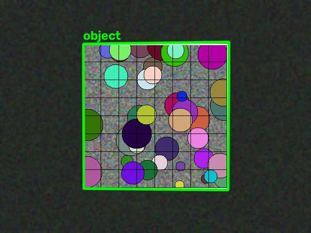
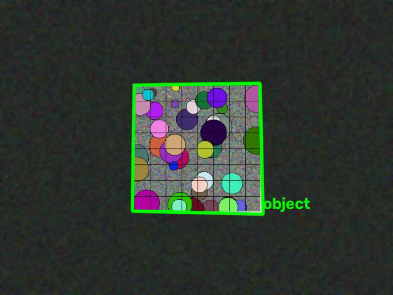
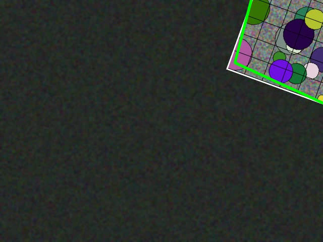
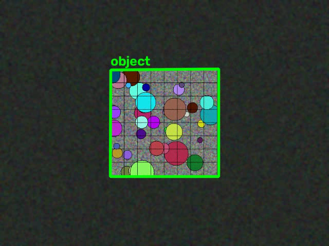

# ЛР2. Трекинг объекта на видео на основе ключевых точек

**Цель работы:** реализовать простейший алгоритм трекинга объекта на видео на основе ключевых точек.

Программа принимает видео, первым кадром которого является крупное изображение отслеживаемого
объекта. На каждом кадре, где объект виден, вокруг него рисуется рамка с подписью.

Язык реализации — Python, библиотеки — OpenCV и NumPy.

---

## 1. Теоретическая база

### Ключевые точки и дескрипторы
Ключевые точки — характерные локальные фрагменты изображения (углы, края, пятна),
инвариантные к небольшим геометрическим и фотометрическим изменениям. Каждой точке
ставится в соответствие **дескриптор** — вектор, описывающий локальную окрестность точки.
Сравнение дескрипторов позволяет находить соответствия между изображениями (эталоном и кадром).

### ORB (Oriented FAST and Rotated BRIEF)
ORB сочетает детектор **FAST** и дескриптор **BRIEF** с добавлением ориентации и поворотной
инвариантности. Дескриптор BRIEF — бинарная строка, поэтому сравнение выполняется быстро по
метрике **Хэмминга**. Детектор строит **пирамиду масштабов**, что обеспечивает частичную
масштабную инвариантность. ORB свободен для использования и работает в реальном времени.

### Ratio-тест Лоу (Lowe's ratio test)
Для каждой ключевой точки эталона находятся два ближайших соседа среди дескрипторов кадра.
Сопоставление считается надёжным, если
`d1 < ratio · d2` (обычно `ratio ≈ 0.75`). Это отсеивает неоднозначные (ложные) сопоставления.

### Гомография и RANSAC
Так как объект плоский, его положение на кадре описывается **гомографией** — проективным
преобразованием 3×3, переводящим точки эталона в точки кадра. Оценка гомографии по набору
сопоставлений выполняется методом **RANSAC**, который устойчив к выбросам: случайные
подмножества из 4 пар используются для построения гипотезы, а «правильная» гипотеза
выбирается по числу поддерживающих её точек (inlier'ов).

---

## 2. Описание разработанной системы

### Архитектура
Проект состоит из трёх модулей:

| Файл | Назначение |
|------|-----------|
| `tracker.py` | Основной алгоритм трекинга и CLI для обработки видео |
| `generate_test_videos.py` | Генерация синтетических тестовых видео |
| `evaluate.py` | Оценка точности трекинга (IoU с ground truth) |

### Алгоритм трекинга (`tracker.py`)
1. **Инициализация.** Первый кадр видео принимается за крупное изображение объекта и
   становится **эталоном**. Для эталона вычисляются ключевые точки и дескрипторы ORB
   (`cv2.ORB_create` с расширенной пирамидой масштабов, `nlevels=12` — покрытие до ~7×).
2. **Для каждого следующего кадра:**
   - вычисляются ключевые точки и дескрипторы кадра;
   - дескрипторы сопоставляются с эталоном (`cv2.BFMatcher`, метрика HAMMING, `k=2`);
   - применяется ratio-тест Лоу (`ratio=0.75`);
   - по оставшимся парам оценивается гомография (`cv2.findHomography`, `RANSAC`);
   - углы эталона проецируются через гомографию (`cv2.perspectiveTransform`) —
     полученный четырёхугольник является рамкой объекта;
   - если число inlier'ов ≥ порога, рамка (зелёная) и подпись «object» рисуются на кадре,
     иначе выводится красная подпись «object: not found».

### Генерация тестовых данных
Так как приложенного образца видео в каталоге не оказалось, тестовые видео созданы
синтетически. Формат каждого видео согласован с алгоритмом:
- **кадр 0** — крупное изображение текстурированного объекта (эталон), заполняющее кадр;
- **кадры 1..60** — сцена 640×480, где этот же плоский текстурированный объект движется
  на шумовом фоне.

Объект — случайная текстура с цветными пятнами, сеткой и чёткой рамкой (большое число
ключевых точек). Подготовлены 4 видео:

| Видео | Сценарий |
|-------|----------|
| `test1_translation` | поступательное движение + лёгкий поворот |
| `test2_scale_rotation` | масштабирование (приближение) + полный оборот |
| `test3_offscreen` | объект частично выходит из кадра и возвращается |
| `own1_object` | «своё» видео: похожий объект, диагональное движение + поворот |

## 3. Результаты работы и тестирования системы

### Метрики
Оценка проводилась по двум показателям:
- **доля кадров с найденным объектом** — процент кадров сцены, где алгоритм построил рамку;
- **средний IoU** — пересечение рамки алгоритма с истинным положением объекта (для кадров,
  где объект полностью в кадре).

| Видео | Найдено | Средний IoU | Среднее число inlier'ов |
|-------|--------:|------------:|------------------------:|
| `test1_translation` | 60/60 (100%) | 0.991 | 113.5 |
| `test2_scale_rotation` | 59/60 (98.3%) | 0.967 | 62.8 |
| `test3_offscreen` | 60/60 (100%) | — * | 76.0 |
| `own1_object` | 60/60 (100%) | 0.977 | 75.1 |

\* для `test3` IoU не вычислялся, так как объект частично выходит из кадра.

### Примеры размеченных кадров
| Тест 1 (поступательное движение) | Тест 2 (масштаб + вращение) |
|---|---|
|  |  |
| **Тест 3 (уход из кадра)** | **Своё видео** |
|  |  |

### Анализ
- Наиболее простой случай (поступательное движение) — 100% кадров, IoU 0.99.
- Самый сложный случай — совмещение **масштабирования и вращения** (`test2`): при очень
  маленьком объекте (начальный масштаб 0.4) алгоритм не находит объект в одном кадре из 60
  (98.3%). Причина — крайне малый размер объекта даёт слишком мало надёжных сопоставлений.
- В `test3` при уходе объекта за границу кадра рамка корректно продолжается за края
  изображения; ложных срабатываний на фоне не наблюдается.
- Расширение пирамиды масштабов ORB (`nlevels=12`) заметно улучшило устойчивость
  к масштабным изменениям (потери в `test2` сократились с 6 до 1 кадра).

### Как запустить
```bash
python3 -m venv .venv
source .venv/bin/activate
pip install -r requirements.txt

# генерация тестовых видео (если нужны)
python generate_test_videos.py

# трекинг одного видео: результат сохраняется в *_tracked.mp4
python tracker.py videos/test1_translation.mp4

# оценка точности IoU
python evaluate.py
```

## 4. Выводы по работе
1. Реализован работающий трекинг плоского текстурированного объекта на основе ключевых точек
   ORB, сопоставления дескрипторов по Хэммингу с ratio-тестом Лоу и оценки гомографии методом
   RANSAC.
2. Алгоритм уверенно отслеживает объект при поступательном движении, повороте, масштабировании
   и частичном выходе из кадра (точность ≥ 98%, IoU ≥ 0.97 на полноэкранных кадрах).
3. Ограничения: алгоритм ориентирован на **плоские текстурированные** объекты; при очень малом
   размере объекта или резком изменении масштаба, выходящем за диапазон пирамиды ORB, надёжность
   падает.
4. Подход оправдан для детекции по эталону «один кадр → слежение», но для полной робастности
   (перекрытия, деформации, резкие скачки) целесообразно комбинировать его с методами
   пересопоставления или фильтрами состояния (например, KCF / MedianFlow из OpenCV).

## 5. Использованные источники
1. OpenCV documentation — *Feature Matching* и *Homography*:
   https://docs.opencv.org/4.x/db/d27/tutorial_py_table_of_contents_feature2d.html
2. E. Rublee et al., *ORB: an efficient alternative to SIFT or SURF*, ICCV 2011.
3. D. Lowe, *Distinctive Image Features from Scale-Invariant Keypoints*, IJCV 2004 (ratio-тест).
4. M. A. Fischler, R. C. Bolles, *Random Sample Consensus: A Paradigm for Model Fitting*,
   Communications of the ACM, 1981.